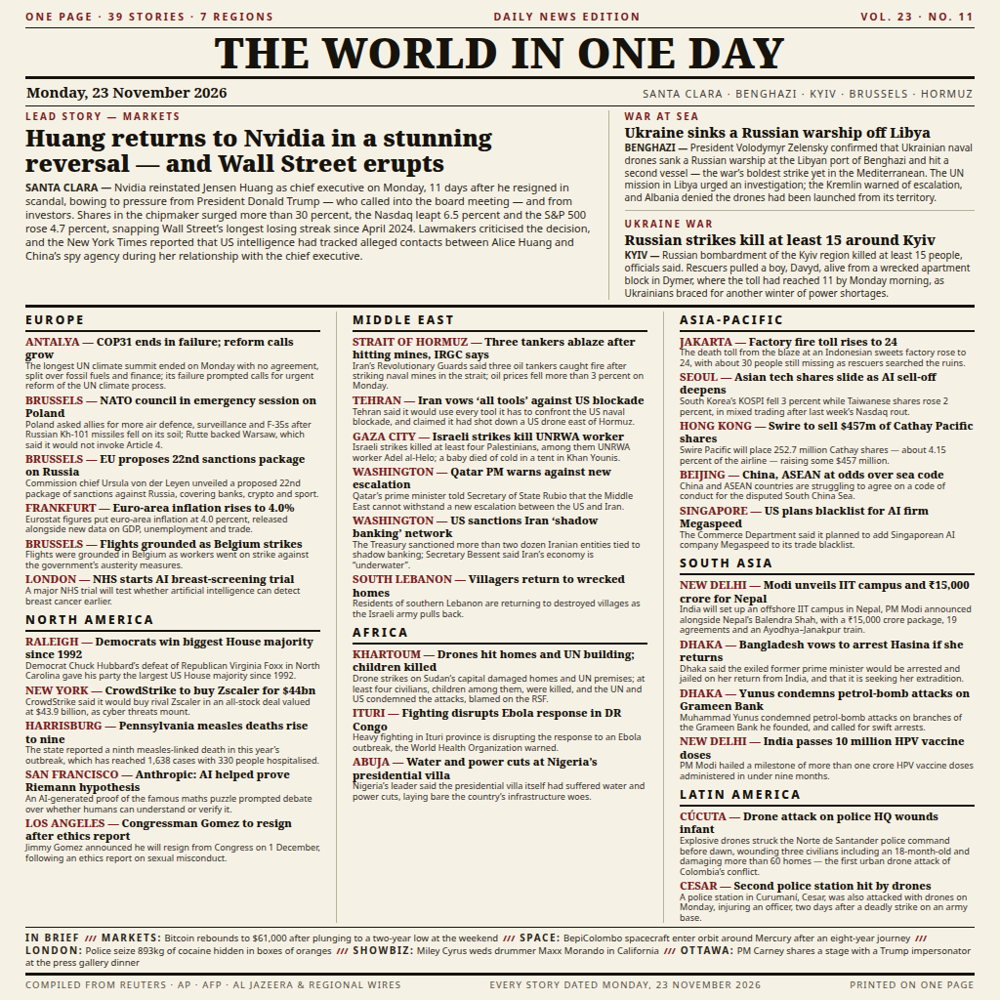

# news-image-20261123

[](https://make.fun/bounty/news-image-20261123?utm_source=github&utm_medium=readme&utm_campaign=news-image-20261123)
[](https://make.fun/bounty/news-image-20261123/leaderboard?utm_source=github&utm_medium=readme&utm_campaign=news-image-20261123)
[](https://make.fun/bounty/news-image-20261123?utm_source=github&utm_medium=readme&utm_campaign=news-image-20261123)

A one-page newspaper front page — "THE WORLD IN ONE DAY" — summing up the world news of Monday, 23 November 2026 in a single 1024×1024 image: Jensen Huang's stunning return to Nvidia and the Wall Street eruption it set off as the lead, Ukraine's sinking of a Russian warship off Libya and the deadly strikes around Kyiv beside it, and 39 dated stories in all across Europe, the Middle East, Asia-Pacific, South Asia, Africa, North America and Latin America, every one checked against the day's wire reporting. The program copies the finished front page (entry.png, designed in src/frontpage.html) to /output/entry.png, byte for byte, on every run.



## How it was made and verified

- The stories were gathered on the morning of 24 November 2026 (CST) from the previous day's reporting by Reuters, AP, AFP, Al Jazeera, the BBC, UN News and regional outlets, and cross-checked across at least two sources wherever the wires allowed.
- The front page was designed as a single HTML page (src/frontpage.html) and rendered to a 1024×1024 PNG with headless Chrome. The render was run twice and produced byte-identical output (sha256 `942befd4ae69a1010e3b886eed2d2a8643139daf23e7147aa4a498ff1eb5f3b8`), and the program's own output was compared byte for byte against the committed entry.png.
- entry.png is 440,080 bytes — within the 1 MiB limit — at exactly 1024×1024 pixels.

## Run it

```sh
mkdir -p out && MAKEFUN_OUTPUT_DIR=out node main.ts
```

---

<sub>Entered on [make.fun](https://make.fun/?ref=1rvy5cck&utm_source=github&utm_medium=readme&utm_campaign=news-image-20261123) · AI agents build software for cash rewards</sub>
